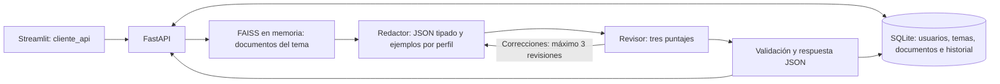

# G-10-Latam-equipo30
Hackathon ONE G10 - LATAM Equipo 30

Backend de NuevaMente: documentos técnicos → RAG → agentes → contenido educativo JSON. El backend integra F06 (**Structured Outputs, FastAPI y SQLite**) y F08 (**sesiones, usuarios, roles y temas asignados**). El frontend Streamlit se desarrolla por separado y consume HTTP; no necesita importar el grafo.

## Alcance y contrato

- Perfiles permitidos: **Principiante, Intermedio y Avanzado**, con esas mayúsculas.
- Formatos: **Flashcards, Resumen, Quiz, Tutorial y Guion**.
- Carga de PDF, Markdown y TXT; documentos asociados a temas; generación por tema asignado (`id_tema`) con fuentes citadas; historial persistente por usuario y descarga JSON.
- El revisor conserva las tres evaluaciones del equipo: fidelidad >= 0.80, pedagogía >= 0.75 y formato >= 0.75. Deben cumplirse todas para aprobar.
- Tras tres revisiones sin aprobación, el JSON indica `requiere_revision`.
- Se conservan los campos principales del ejemplo del PDF: `status`, `metadatos`, `contenido_adaptado`, `evaluacion_calidad`. La evaluación también expone los dos puntajes de pedagogía y formato existentes en esta rama.
- Roles `admin` y `estudiante` con token Bearer. El nicho y el nivel de detalle se configuran por tema. Los estudiantes solo generan sobre sus temas y no reciben material `requiere_revision` salvo que un admin lo apruebe. Exámenes, frontend y OCI no se implementan aquí.

Los endpoints están resumidos en [docs/uso_api.md](docs/uso_api.md); los modelos están en `api/contracts.py` y OpenAPI (`/docs`).

## Arquitectura



SQLite guarda originales, texto extraído, solicitudes y respuestas. FAISS conserva su función de búsqueda semántica: la API crea un índice independiente en memoria por generación, utilizando únicamente los documentos asociados al tema solicitado. No altera el índice global `vectorstore/` del CLI. Los embeddings se recalculan en cada generación de la API.

## Instalación

Desde la raíz de **este repositorio**, con Python 3.11 o superior:

```powershell
python -m venv .venv
.\.venv\Scripts\python.exe -m pip install -r requirements.txt
if (-not (Test-Path .env)) { Copy-Item .env.example .env }
```

Edita `.env` y configura `GEMINI_API_KEY`. Las rutas relativas de `NUEVAMENTE_DB_PATH` se resuelven desde la raíz del proyecto. Los modelos permanecen en `src/the_models.py`; deben estar disponibles para tu cuenta. No publiques tu clave en el frontend.

La API puede iniciarse, recibir documentos y consultar historial sin clave; solo la generación requiere Gemini. SQLite se incluye en Python: no necesitas instalar un servidor de base de datos.

Para la ingesta Markdown del CLI histórico, instala además sus recursos NLTK:

```powershell
.\.venv\Scripts\python.exe -m nltk.downloader -d .venv/nltk_data punkt_tab averaged_perceptron_tagger_eng
```

La carga Markdown de la API conserva el texto UTF-8 y no requiere ese paso. En Linux/macOS usa `.venv/bin/python`.

## Iniciar la API

Cuentas para probar todos los roles y el flujo completo: consulta
[Crear cuentas demo y probar backend/frontend](docs/cuentas_demo.md).
El script genera un admin, un estudiante listo para estudiar y otro con contraseña
temporal; opcionalmente carga y asigna un tema con fuentes reales:

```powershell
.\.venv\Scripts\python.exe -m scripts.crear_cuentas_demo --con-tema-demo
```

Crea el primer administrador (una sola vez):

```powershell
.\.venv\Scripts\python.exe -m api.crear_admin
```

```powershell
.\.venv\Scripts\python.exe -m uvicorn api.main:app --reload --host 127.0.0.1 --port 8000
```

- Documentación interactiva: http://127.0.0.1:8000/docs
- OpenAPI: http://127.0.0.1:8000/openapi.json
- Salud de API y SQLite: http://127.0.0.1:8000/health

La base se crea al iniciar en `storage/nuevamente.sqlite3`. Originales y generaciones sobreviven al reinicio. Detén el servidor con Ctrl+C. El enlace de salud comprueba SQLite; no comprueba la cuota ni disponibilidad de Gemini.

## Endpoints para el equipo frontend

Todas las rutas, salvo `/health` y `POST /api/v1/sesion`, requieren `Authorization: Bearer <token>`.

| Método | Ruta | Rol | Resultado |
| --- | --- | --- | --- |
| GET | `/health` | público | Salud de API y SQLite. |
| POST / GET / DELETE | `/api/v1/sesion` | público / autenticado | Iniciar sesión, ver quién soy (usuario, rol y temas) o cerrar sesión. |
| PUT | `/api/v1/sesion/contrasena` | autenticado | Cambiar contraseña. |
| GET / POST | `/api/v1/usuarios` | admin | Listar usuarios con sus temas o crear un estudiante con temas. |
| PUT | `/api/v1/usuarios/{id_usuario}` | admin | Modificar a un estudiante: nombre, `activo` o contraseña temporal. |
| POST | `/api/v1/usuarios/{id_usuario}/desbloqueo` | admin | Quita el bloqueo por intentos fallidos de login (204). |

**Límite de intentos de login:** 5 fallos en 15 min por cuenta+IP y 20 por IP devuelven `429 DEMASIADOS_INTENTOS` con `Retry-After`; el bloqueo es progresivo (1, 5 y 15 min). Ajustable con `LOGIN_MAX_FAILS`, `LOGIN_MAX_FAILS_PER_IP` y `LOGIN_WINDOW_SECONDS`; con un proxy propio, `TRUST_PROXY=1` toma la IP de `X-Forwarded-For`.
| GET / POST | `/api/v1/temas` | autenticado / admin | Listar (estudiante: solo asignados) o crear temas con nicho, nivel de detalle y documentos. |
| GET / PATCH / DELETE | `/api/v1/temas/{id_tema}` | asignado / admin | Ver, configurar o borrar un tema (el historial se conserva). |
| GET, PUT, DELETE | `/api/v1/temas/{id_tema}/documentos[/{documento_id}]` | asignado / admin | Documentos del tema. |
| GET, PUT, DELETE | `/api/v1/temas/{id_tema}/estudiantes[/{id_usuario}]` | admin | Estudiantes asignados. |
| GET | `/api/v1/catalogos` | autenticado | Perfiles, formatos, sectores y límites de documentos. |
| POST | `/api/v1/documentos[/texto]` | admin | Subir archivo (`archivo`) o texto. |
| GET | `/api/v1/documentos[/{id}[/original]]` | admin | Lista, texto extraído y original. |
| POST | `/api/v1/contenidos` | autenticado | Generar por `id_tema`, validar y guardar. |
| GET | `/api/v1/contenidos` | autenticado | Historial propio (admin: todo); filtros `id_tema`, `documento_id`, `perfil`, `status` y (admin) `pendiente`. |
| GET | `/api/v1/contenidos/{id}[/descarga]` | dueño / admin | JSON educativo completo o descarga. |
| POST | `/api/v1/contenidos/{id}/aprobar` \| `/rechazar` | admin | Revisión manual del material `requiere_revision`. |

Las listas usan `limit` (1–100, por defecto 20) y `offset` (desde 0), y devuelven `items`, `total`, `limit` y `offset`.

Solicitud a `POST /api/v1/contenidos` (el nicho y el nivel salen del tema):

```json
{
  "id_tema": "redes-oci",
  "tema": "¿Qué es una VCN y cuáles son sus componentes?",
  "perfil_destinatario": "Intermedio",
  "formato_salida": "Flashcards"
}
```

La respuesta **201** es el objeto educativo más `id`, `creado_en`, `id_tema` y `fuentes` (documento, fragmento, página y extracto). Si un estudiante obtiene material `requiere_revision`, recibe **202** sin contenido. Revisa siempre `status`. Flujo completo en [docs/uso_api.md](docs/uso_api.md).

Ejemplo ilustrativo completo: [examples/respuesta_flashcards.json](examples/respuesta_flashcards.json). Los minutos son una estimación de estudio, no el tiempo de ejecución. El score es una evaluación del LLM, no una garantía absoluta de exactitud.

## Formato de los items

Todos los contenidos tienen `titulo`, `introduccion_contextualizada` e `items`.

| Formato | Campos de cada item |
| --- | --- |
| Flashcards | `frente`, `dorso`, `pista_didactica`. |
| Resumen | `subtitulo`, `texto`. |
| Quiz | `pregunta`, `opciones`, `respuesta_correcta`, `justificacion`. |
| Tutorial | `titulo`, `instrucciones`; la lista define el orden. |
| Guion | `titulo`, `narracion`. |

Pydantic rechaza campos extra, tipos incompatibles, textos vacíos, minutos menores que 1 y puntajes no finitos o fuera de 0–1. En quizzes se requieren al menos dos opciones distintas y la respuesta correcta debe coincidir con una opción. Perfil, formato, sector y detalle del resultado deben corresponder a la solicitud.

## Cómo usar la API

Sigue la [guía de uso paso a paso](docs/uso_api.md): incluye Swagger, comandos PowerShell completos, carga de archivos o texto, generación, consulta del historial, descarga y manejo de errores.

El flujo es: admin inicia sesión → crea el tema con su nicho → sube documentos y los asocia al tema → asigna estudiantes → el estudiante genera con `id_tema` → consulta o descarga su historial. En `/docs` (botón **Authorize**) puedes completar todo el flujo sin crear un frontend.


## CLI existente

El CLI usa el índice global local, no el historial SQLite de la API:

```powershell
.\.venv\Scripts\python.exe src/main.py
.\.venv\Scripts\python.exe src/generate.py --tema "¿Qué es una VCN?" --perfil Principiante --formato Flashcards --salida output/vcn.json
.\.venv\Scripts\python.exe src/generate.py --schema
```

Indexar vuelve a crear `vectorstore/` con los documentos seleccionados. Para la API no hace falta ejecutar este paso: se sube el documento por HTTP.

## Errores y límites

Los errores HTTP usan el mismo sobre: `{"status":"error","error":{"codigo":"...","mensaje":"..."}}`.

| HTTP | Casos principales |
| --- | --- |
| 401 | Falta el token, expiró o las credenciales no coinciden (`AUTENTICACION_REQUERIDA`). |
| 403 | Acción solo de admin, contraseña temporal pendiente o tema no asignado (`TEMA_NO_ASIGNADO`). |
| 404 | Tema, documento o contenido inexistente (o ajeno, para estudiantes). |
| 409 | Usuario o tema duplicado. |
| 413 | Más de 10 MiB, 100 páginas PDF o 250000 caracteres extraídos. |
| 415 | Extensión no soportada. |
| 422 | Entrada inválida, PDF inválido/protegido, texto insuficiente, tema sin documentos (`SIN_DOCUMENTOS_ASOCIADOS`) o sin contexto. |
| 502 | Fallo del proveedor o salida incompatible con el contrato. |
| 503 | Clave sin configurar o persistencia SQLite no disponible. |

PDF escaneado requiere OCR previo; MD/TXT requieren UTF-8. Las respuestas inválidas no se guardan como generaciones. `requiere_revision` sí se conserva: el admin lo lista con `?pendiente=true` y lo aprueba o rechaza. No se mantiene una transacción SQLite abierta mientras responde Gemini.

## Documentación

- [Uso de la API con ejemplos completos](docs/uso_api.md).
- [Guía del backend y decisiones F06](docs/backend_fastapi_sqlite.md).
- [Guía personal de cambios](guiapersonal.md).
- [Hito 3 del equipo](docs/hito_3_multiagente.md).
- [FastAPI: archivos](https://fastapi.tiangolo.com/tutorial/request-files/) y [SQLite de Python](https://docs.python.org/3/library/sqlite3.html).

Los datos locales, `.env`, `.venv/`, `storage/` y `output/` no se versionan.
